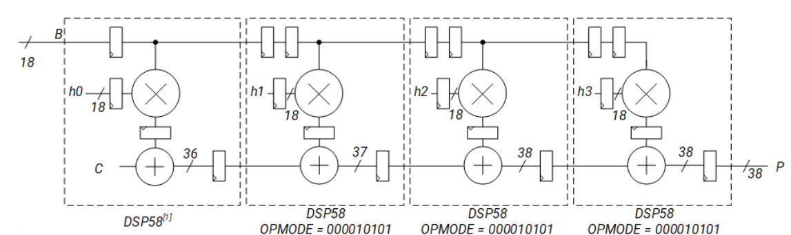
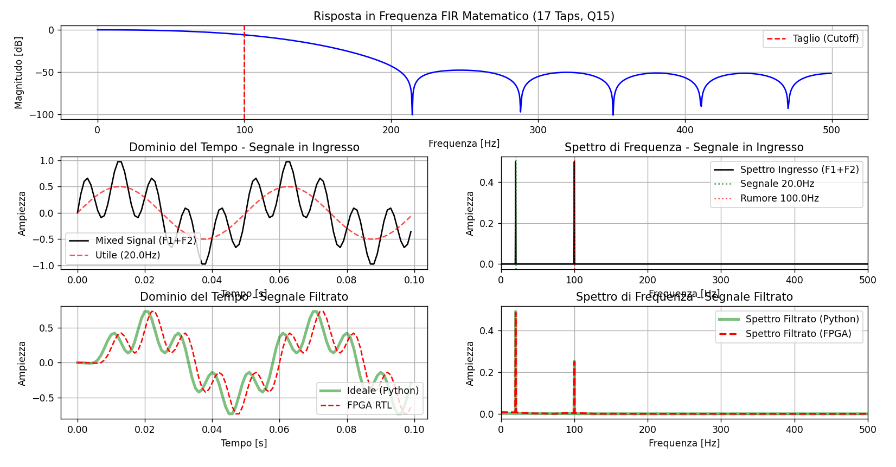

# VHDL Systolic Array FIR Filter 🚀


High-performance Finite Impulse Response (FIR) filter in VHDL based on a **Weight-Stationary** systolic array architecture, specifically optimized for AMD/Xilinx DSP slices (`DSP48E2` / `DSP58`). Includes an automated verification environment with a Python **Golden Model** for time-domain and spectral (FFT) analysis.

---

## Table of Contents
1. [Theoretical Background: Systolic Arrays and Hardware FIR Filters](#1-theoretical-background-systolic-arrays-and-hardware-fir-filters)
2. [Hardware Architecture (RTL)](#2-hardware-architecture-rtl)
3. [Simulation and Verification Methodology](#3-simulation-and-verification-methodology)
4. [Repository Structure](#4-repository-structure)
5. [Future Improvements](#5-future-improvements)

---

## 1. Theoretical Background: Systolic Arrays and Hardware FIR Filters

### What is a Systolic Array?
Inspired by the human circulatory system (*systole*), a systolic array is a homogeneous network of tightly coupled Processing Elements (PEs) that rhythmically "pumps" data through the chip. Instead of repeatedly reading from and writing to a centralized memory, data flows directly from one PE to the next, executing complex parallel computations on every clock cycle.

### The "Routing Wall" and Data Reuse
An $N$-tap FIR filter computes the output $y[n]$ by performing the discrete convolution between the input signal $x[n]$ and a set of $N$ coefficients $h[k]$:

$$y[n] = \sum_{k=0}^{N-1} h[k] \cdot x[n-k]$$

When implemented using traditional combinational logic or direct-form structures, this equation generates a massive adder tree and high-fanout nets. On an FPGA, this translates into long interconnect delays (**"Routing Wall"**) that degrade timing closure and severely limit the maximum operating frequency ($F_{max}$). A systolic architecture solves this problem by guaranteeing that interconnections occur **exclusively between adjacent blocks**.

### The Double Systolic Delay (Mathematical Justification)
To keep the FIR equation mathematically exact within a distributed pipelined architecture (Weight-Stationary), the intersection between the propagating input data $X$ and the partial sums $Y$ must be perfectly phase-aligned. To achieve this, **the input data path undergoes 2 clock delays per node, whereas the accumulator path undergoes only 1 clock delay.**

The table below illustrates the **Wavefront Timing** for a 2-tap filter computing $y[n] = h_0 \cdot x[n] + h_1 \cdot x[n-1]$:

| Clock | Input ($X$) | PE 0 (Weight $h_0$) | Extra $X$ Delay | PE 1 (Weight $h_1$) | System Output ($Y_{out}$) |
| :---: | :---: | :--- | :--- | :--- | :--- |
| **0** | $x[0]$ | Computes: $y_0 = h_0 \cdot x[0]$ | Latches $x[0]$ (1st delay) | Idle | - |
| **1** | $x[1]$ | Computes: $y_1 = h_0 \cdot x[1]$ <br> *Sends $y_0$ to PE1* | Latches $x[1]$ <br> *Sends $x[0]$ to PE1* (2nd delay) | Idle (receives $y_0$, waiting for $x[0]$) | - |
| **2** | $x[2]$ | Computes: $y_2 = h_0 \cdot x[2]$ <br> *Sends $y_1$ to PE1* | Latches $x[2]$ <br> *Sends $x[1]$ to PE1* | Receives $y_1$ and $x[0]$. <br> Computes: **$y_1 + h_1 \cdot x[0]$** | Partial $y[0]$ exits |
| **3** | $x[3]$ | Computes: $y_3 = h_0 \cdot x[3]$ <br> *Sends $y_2$ to PE1* | Latches $x[3]$ <br> *Sends $x[2]$ to PE1* | Receives $y_2$ and $x[1]$. <br> Computes: **$y_2 + h_1 \cdot x[1]$** | **Full $y[1]$ exits!** <br> $(h_0 x[1] + h_1 x[0])$ |

As shown above, at Clock 2, PE 1 simultaneously receives the partial sum associated with sample $x[1]$ and the delayed input sample $x[0]$, enabling the exact computation of the first valid filtered sample $y[1]$ (which appears registered at the system output on Clock 3).

---

## 2. Hardware Architecture (RTL)

### Processing Element Microarchitecture (`MAC.vhd`)
Each individual PE is heavily inspired by the native **AMD/Xilinx DSP48E2 / DSP58** slice architecture. To map seamlessly onto the dedicated silicon primitives and achieve maximum operating frequencies, the Multiply-Accumulate (MAC) operation is broken down into a deep pipeline.


> *Reference systolic FIR structure from the [AMD Versal DSP Engine Documentation (AM004)](https://docs.amd.com/r/en-US/am004-versal-dsp-engine/Systolic-FIR-Filter).*

The VHDL code is written to infer these exact internal hardware registers:
1. **A/B-Reg:** Input stabilization and synchronization (provides the double data delay across the chain).
2. **M-Reg (Multiplier Register):** Intermediate pipeline register to break the critical combinational path of the multiplier.
3. **P-Reg (Accumulator Register):** Final output register storing the sum with the upstream block (single accumulator delay).

### 1D Systolic Chain (`Systolic_FIR.vhd`)
The PEs are cascaded into a one-dimensional chain using a VHDL `generate` statement. Internal routing exploits the dedicated silicon cascade buses inside the AMD DSP columns (`PCIN`/`PCOUT` for partial sums, `ACIN`/`ACOUT` for input data), keeping the high-speed signal path completely out of the general-purpose FPGA routing fabric.

---

## 3. Simulation and Verification Methodology

Validation goes beyond visual waveform inspection by employing an automated co-simulation workflow against a software **Golden Model**.

### Python Golden Model Workflow
A Python script (`scipy.signal`) generates both the composite test stimulus (low-frequency target signal + high-frequency noise) and the ideal mathematical filter response. Since the hardware FIR operates in integer arithmetic, the floating-point coefficients are quantized to **16-bit Q15** fixed-point format and exported to `coeff.txt`.

### VHDL Testbench and Spectral Analysis
The `tb_Systolic_FIR.vhd` testbench module uses the standard `TEXTIO` library to read the input vectors, stimulate the DUT, and dump the 48-bit accumulator output (truncated to 32 useful bits) into `output.txt`.  
Finally, Python parses the hardware output log and performs a **Fast Fourier Transform (FFT)** to compare the frequency spectra.


> *Verification dashboard generated by the Python script. In the bottom-right plot, the FFT analysis demonstrates the exact overlap between the ideal Python filter (green) and the FPGA fixed-point hardware computation (dashed red).*

### Implementation Results
*Data extracted from Post-Implementation (Place & Route completed) reports.*

| Target FPGA | Clock Period Constraint | Setup WNS | Equivalent Max Freq ($F_{max}$) | Throughput |
| :--- | :--- | :--- | :--- | :--- |
| **Zynq UltraScale+ (ZCU111)** | 4.0 ns (250 MHz) | +2.94 ns | **~ 1 GHz** (Silicon-limited) | 1 Sample / Clock |
| **Artix-7 (Arty A7-35T)** | 10.0 ns (100 MHz) | *TBD* | **> 300 MHz** | 1 Sample / Clock |

---

## 4. Repository Structure

```text
├── rtl/
│   ├── my_pkg.vhd          # Custom data types definition (memory_array)
│   ├── MAC.vhd             # Pipelined Processing Element
│   └── Systolic_FIR.vhd    # Top-Level Systolic Array FIR
├── sim/
│   └── tb_Systolic_FIR.vhd # VHDL Testbench with file I/O
├── model/
│   └── fir_golden_model.py # Python script for stimulus generation and FFT
└── README.md
```

---

## 5. Future Improvements
1. **AXI4-Stream Interface:** Implementation of standard `TVALID`/`TREADY`/`TDATA` handshaking for plug-and-play integration in Vivado IP Integrator.
2. **AXI4-Lite Interface:** Runtime weight reconfiguration via memory-mapped registers.
3. **Shift, Round & Saturate Logic:** Dedicated output stage to extract normalized 16-bit samples from the 48-bit accumulator without overflow risk.
